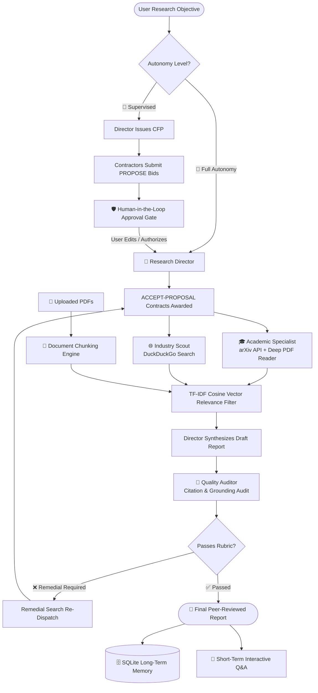

# 🧠 Autonomous AI Research Assistant

<p align="center">
  
  
  
  
  
  
</p>

An enterprise-grade, stateful **Multi-Agent Research Assistant** designed like a high-performing research institute. Instead of relying on a single, monolithic LLM prompt, the system deploys specialized, role-based agents that negotiate tasks via the **Contract Net Protocol (CNP)**, perform deep academic and web retrieval, run autonomous rubric-based self-correction loops, and support interactive human-in-the-loop query authorization.

---

## 🌟 Key Architectural Pillars

```
┌─────────────────────────────────────────────────────────────────────────────────────────┐
│                           AUTONOMOUS RESEARCH ASSISTANT                                 │
├───────────────────────────────┬───────────────────────────────┬─────────────────────────┤
│ 👥 Role-Based Multi-Agent Team│ 🔄 Self-Correction Loop       │ 🛡️ Adjustable Autonomy  │
│ • Research Director           │ • Rubric-based peer audit     │ • Full Autonomy Mode    │
│ • Academic Specialist (arXiv) │ • Citation density scoring    │ • Supervised (HITL) Mode│
│ • Industry Scout (Web)        │ • Remedial search re-dispatch │ • Pre-search query gate │
│ • Quality Critic (Auditor)    │ • Metacognitive self-healing  │ • Human query editing   │
├───────────────────────────────┼───────────────────────────────┼─────────────────────────┤
│ 📄 Deep Document Ingestion    │ 🧠 Dual-Tier Memory System    │ 🌐 Hybrid LLM Inference │
│ • Full-text arXiv PDF fetcher │ • Short-term: Context buffer  │ • Online: Gemini Flash  │
│ • User-uploaded PDF parsing   │ • Long-term: SQLite store     │ • Offline: Ollama local │
│ • Sliding-window chunking     │ • Full session reload & search│ • Auto-fallback handler │
└───────────────────────────────┴───────────────────────────────┴─────────────────────────┘
```

### 1. 👥 Role-Based Agents & Contract Net Protocol (CNP)
- **Specialized Division of Labor**: Tasks are partitioned among a **Research Director** (Coordinator), **Academic Literature Specialist** (arXiv Contractor), **Industry Intelligence Scout** (Web Contractor), and **Quality Auditor** (Peer Review Monitor).
- **Formal FIPA-ACL Negotiation**: Communication follows the structured Contract Net Protocol (`CFP` ➔ `PROPOSE` ➔ `ACCEPT-PROPOSAL` ➔ `INFORM` ➔ `REQUEST`), complete with contractor bids, confidence scoring, and an interactive message audit trace.

### 2. 🔄 Autonomous Self-Correction & Reflection Loop
- **Objective Rubric Auditing**: A dedicated Critic agent inspects draft reports against formal criteria: citation density ($\ge 0.60$) and source grounding ($\ge 0.70$).
- **Self-Healing Remedial Cycles**: If the audit identifies unsupported assertions or weak citation coverage, it autonomously drafts targeted remedial queries, re-engages contractors, and synthesizes missing evidence into the report without human intervention.

### 3. 🛡️ Human-in-the-Loop (HITL) with Adjustable Autonomy Gate
- **Execution Decoupling**: Choose between **Full Autonomy** (uninterrupted end-to-end execution) and **Supervised Mode** (mixed-initiative collaboration).
- **Interactive Approval Checkpoint**: In Supervised Mode, the agent pauses after contractor bidding, allowing the researcher to inspect confidence ratings, edit or prune search queries, and inject domain-specific keywords before search API execution.

### 4. 📄 Deep Paper Ingestion & Document RAG
- **Automated arXiv PDF Reader**: Automatically fetches full-text PDFs for top-ranked papers from arXiv endpoints, parsing comprehensive methodology sections and benchmark tables.
- **Multi-Document User Uploads**: Drop proprietary research papers, whitepapers, or technical briefs directly into the UI.
- **Context-Preserving Sliding Window**: Splits documents into 1,200-character chunks with 150-character overlaps, filtered through a sub-millisecond TF-IDF cosine relevance engine.

### 5. 🧠 Dual-Tier Memory Architecture
- **Short-Term Working Memory**: Sliding-window conversation buffer enabling continuous, context-aware interactive Q&A follow-ups on the generated report.
- **Long-Term Persistent Memory**: Backed by SQLite (`data/memory.db`), permanently storing research objectives, awarded queries, retrieved sources, synthesized reports, and reflection audit metrics. Includes fast keyword search and 1-click dossier loading.

### 6. 🌐 Hybrid Online & Offline Inference
- **Cloud Mode**: Ultra-fast generation using Google Gemini 2.5 / 3.6 Flash with automatic rate-limit backoff.
- **Offline / Private Mode**: Complete air-gapped local execution via Ollama (`qwen2.5:3b`, `llama3.2`).

---

## 🏗️ System Workflow Architecture



---

## 📁 Repository Structure

```
ai_research_assistant/
├── app.py                         # Streamlit UI with HITL Gate & Reflection Timeline
├── architecture.md                # Comprehensive technical specification & diagrams
├── agent_concepts_explained.md    # Plain-English guide to multi-agent concepts
├── requirements.txt               # Production Python dependencies
├── .env.example                   # Environment configuration template
├── data/
│   └── memory.db                  # Persistent SQLite long-term storage
└── src/
    ├── __init__.py
    ├── agent.py                   # AutonomousResearchAgent pipeline coordinator
    ├── memory.py                  # ShortTermMemory & LongTermMemory managers
    ├── protocols.py               # FIPA-ACL performatives & CNP data models
    ├── schemas.py                 # Pydantic schemas (ResearchPlan, CritiqueAuditResult)
    ├── agents/
    │   ├── __init__.py
    │   ├── director.py            # ResearchDirector (Coordinator & Synthesizer)
    │   ├── academic_worker.py     # AcademicLiteratureAgent (arXiv + PDF reader)
    │   ├── industry_worker.py     # IndustryIntelligenceAgent (Web search)
    │   └── critic_worker.py       # QualityCriticAgent (Rubric-based auditor)
    └── tools/
        ├── __init__.py
        ├── arxiv_search.py        # arXiv API client
        ├── web_search.py          # DuckDuckGo search client
        ├── pdf_reader.py          # Full-text PDF extraction & sliding-window chunker
        └── rag.py                 # Sub-millisecond TF-IDF vector relevance filter
```

---

## 🚀 Quickstart Guide

### Prerequisites
- **Python 3.10+**
- (Optional for Online Mode): Free [Google Gemini API Key](https://aistudio.google.com/)
- (Optional for Offline Mode): [Ollama](https://ollama.com/) running locally (`ollama run qwen2.5:3b`)

### 1. Clone the Repository
```bash
git clone https://github.com/your-username/ai-research-assistant.git
cd ai-research-assistant
```

### 2. Set Up Virtual Environment
```bash
# Windows
python -m venv .venv
.\.venv\Scripts\activate

# Linux / macOS
python3 -m venv .venv
source .venv/bin/activate
```

### 3. Install Dependencies
```bash
pip install -r requirements.txt
```

### 4. Configure Environment Variables
Create a `.env` file in the project root:
```bash
cp .env.example .env
```
Add your API key:
```env
GOOGLE_API_KEY=your_gemini_api_key_here
```

### 5. Launch the Streamlit Interface
```bash
streamlit run app.py
```
Open your browser at **`http://localhost:8501`**.

---

## 🖥️ User Interface Overview

| Feature View | Description |
| :--- | :--- |
| **🛡️ Approval Gate** | Review contractor query bids, modify search terms, and click to authorize execution. |
| **🔄 Reflection Timeline** | Inspect real-time audit metric cards (grounding score, citation density, critique feedback). |
| **📡 Communication Trace** | Expandable FIPA-ACL message log detailing negotiation (`CFP`, `PROPOSE`, `INFORM`). |
| **📄 Document Ingestion** | Toggle deep arXiv PDF downloads and drag-and-drop proprietary research PDFs. |
| **📑 Verified Report** | Rendered Markdown dossier with collapsible evidence citations and 1-click `.md` export. |
| **💬 Interactive Dialogue** | Follow-up conversation widget powered by short-term sliding-window memory. |
| **🗄️ Dossier Archive** | Sidebar repository to search, load, and manage past research sessions stored in SQLite. |

---

## 🛠️ Technology Stack

| Layer | Technology | Purpose |
| :--- | :--- | :--- |
| **Agent Orchestration** | `LangChain Core` | Structured outputs, system prompts, LLM abstraction |
| **LLM Inference** | `gemini-2.5-flash` / `gemini-3.6-flash` | Ultra-fast online reasoning & report generation |
| **Offline Inference** | `ChatOllama` (`qwen2.5:3b`, `llama3.2`) | 100% private, air-gapped local execution |
| **Academic Retrieval** | `arxiv` Python API | Peer-reviewed scientific literature access |
| **Web Retrieval** | `duckduckgo-search` (`ddgs`) | Real-time commercial benchmarks & tech news |
| **Document Processing**| `pypdf` | Byte-stream PDF text extraction & chunking |
| **Relevance Ranking** | TF-IDF Cosine Scoring (`scikit-learn`) | Sub-millisecond semantic evidence filtering |
| **Data Contracts** | `Pydantic v2` | Strict JSON schema validation for bids & audits |
| **Persistence** | `SQLite3` | Persistent relational storage for dossiers & logs |
| **Web UI** | `Streamlit` | Interactive dashboard with real-time progress callbacks |

---

## 🧪 Verification & Testing

Verify that all components and tools are functioning correctly:

```bash
# Syntax compilation across all modules
python -m py_compile src/tools/pdf_reader.py src/agents/academic_worker.py src/agent.py app.py

# Verify PDF extraction, chunking, and agent retrieval integration
python -c "from src.tools.pdf_reader import chunk_document_text; print(f'Chunker OK: {len(chunk_document_text(\"Test text \" * 50))} chunks')"
```

---

## 📖 Additional Documentation
- [architecture.md](architecture.md): In-depth system diagrams, agent prompt definitions, and mathematical scoring rubrics.
- [agent_concepts_explained.md](agent_concepts_explained.md): Plain-English conceptual guide explaining multi-agent coordination, memory, and protocols.

---

## 📜 License
This project is open-source and available under the [MIT License](LICENSE).
