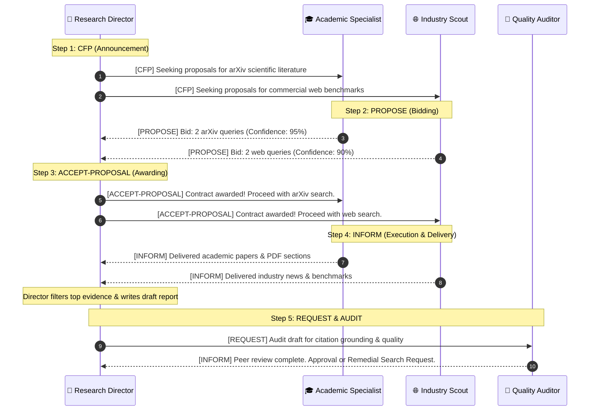

# Understanding Our AI Research Assistant in Simple Terms 🧠

If you look under the hood of our **Autonomous AI Research Assistant**, it is designed like a **high-performing human research lab**. 

Instead of a single AI trying to do everything at once (and getting confused), we have structured the system into seven clear, intuitive building blocks:
1. **Short-Term Memory** (The Desk Scratchpad)
2. **Long-Term Memory** (The Filing Cabinet)
3. **Role-Based Multi-Agent Team** (The Specialists)
4. **Contract Net Protocol (CNP)** (How Agents Negotiate and Hire Each Other)
5. **Autonomous Self-Correction & Reflection Loop** (The Peer-Review Audit & Self-Healing Pipeline)
6. **Human-in-the-Loop (HITL) Adjustable Autonomy Gate** (The Human Supervisor Checkpoint)
7. **Deep Paper Ingestion & Document RAG** (Full-Text Scientific Literature & PDF Reading)

Here is a simple, plain-English breakdown of how each part works, why it matters, and where you can see it in action.

---

## 1. Short-Term Memory (Working Memory) 📝

### The Real-World Analogy
Imagine you are sitting at a desk talking with a colleague. As you converse, you keep the last few sentences in your head so you know what "it" or "that paper" refers to. You don't need to remember what you ate for breakfast 3 weeks ago; you just need enough recent context to have a meaningful dialogue right now.

### Why Does an AI Agent Need It?
By default, **Large Language Models (LLMs) have total amnesia**. Every time you send a prompt, the model starts from a blank slate with zero memory of what was said a second ago. 

Without short-term memory:
* You ask: *"Summarize quantum computing."* ➔ Agent gives you a report.
* You ask: *"Can you explain the 2nd section in simpler words?"*
* The agent gets confused: *"What 2nd section? What were we talking about?"*

### How We Implemented It in Our Code
In [src/memory.py](file:///d:/Projects/ai_research_assistant/src/memory.py), we created the `ShortTermMemory` class:
* **Lives in the Context Window**: It stores ongoing conversation turns (User ➔ Assistant ➔ User ➔ Assistant).
* **Sliding Window Buffer**: LLMs have a fixed token limit (they can only read so much text at once). If a conversation gets too long, the system quietly drops the oldest turns and keeps the most recent 6 exchanges.
* **Where You See It in the App**: Underneath the research report, in the **"💬 Interactive Research Dialogue"** chat box. You can ask follow-up questions like *"What did source [1] say about hardware?"*, and the agent remembers previous answers.

---

## 2. Long-Term Memory (Persistent Storage) 🗄️

### The Real-World Analogy
Imagine the research lab's **archive filing cabinet**. When a big research project is finished, the team binds the documents, labels them with a date and title, and files them away in a drawer so anyone can pull them out next month.

### Why Do We Need It?
Short-term memory only lasts while your current conversation is active. If you close your browser or restart your computer, short-term memory is erased. 

Long-term memory ensures that:
1. Every research report, search query, reflection history, and cited source is **permanently saved**.
2. You can switch between projects without re-running expensive web searches or burning API quotas.
3. You can search across past research topics whenever you want.

### How We Implemented It in Our Code
In [src/memory.py](file:///d:/Projects/ai_research_assistant/src/memory.py), we created the `LongTermMemory` class:
* **Powered by SQLite (`data/memory.db`)**: A reliable, lightweight database stored right on your hard drive.
* **What Gets Saved**:
  * `session_id` (Unique project ID)
  * `objective` & `topic_title`
  * `plan` (Search queries used)
  * `sources` (All collected arXiv papers, web links, and PDF chunks)
  * `final_report` (The verified markdown report)
  * `chat_history` (All follow-up questions asked)
  * `reflection_json` (Audit scores and critique history)
* **Where You See It in the App**: Look at the **Sidebar** under **"🗄️ Long-Term Memory Store"**. You will see your saved dossiers. Click **"📂 Load"** on any past research to restore it instantly!

---

## 3. Role-Based Multi-Agent Team (Division of Labor) 👥

### The Real-World Analogy
If you want to build a house, you don't hire one person to do the plumbing, electrical wiring, bricklaying, architecture, and safety inspections all alone. You hire **specialists** who are world-class at one specific craft.

### Why Role-Based Agents?
A single generic AI prompt often produces generic, superficial results. When we give an agent an **explicit role, clear boundaries, and specific tools**, its focus and output quality skyrocket.

In our project ([src/agents/](file:///d:/Projects/ai_research_assistant/src/agents/)), we have 4 distinct agents:

```
                  ┌───────────────────────────────┐
                  │      👔 Research Director      │  (Coordinator)
                  └───────────────┬───────────────┘
                                  │
         ┌────────────────────────┴────────────────────────┐
         ▼                                                 ▼
┌───────────────────────────────┐         ┌───────────────────────────────┐
│     🎓 Academic Specialist    │         │       🌐 Industry Scout       │
│    (Contractor - arXiv API)   │         │  (Contractor - DuckDuckGo)    │
└───────────────────────────────┘         └───────────────────────────────┘
                                  │
                                  ▼
                  ┌───────────────────────────────┐
                  │      🔬 Quality Auditor       │  (Monitor / Peer Review)
                  └───────────────────────────────┘
```

1. **👔 Research Director (`DirectorAgent` - [src/agents/director.py](file:///d:/Projects/ai_research_assistant/src/agents/director.py))**:
   * **Role**: The Coordinator / Manager.
   * **Job**: Breaks down the user's research request, creates tasks, awards contracts to workers, synthesizes the draft, and incorporates remedial evidence when audits demand revisions.
2. **🎓 Academic Literature Specialist (`AcademicLiteratureAgent` - [src/agents/academic_worker.py](file:///d:/Projects/ai_research_assistant/src/agents/academic_worker.py))**:
   * **Role**: Academic Contractor.
   * **Job**: Searches arXiv and downloads full-text academic PDFs. Deeply understands formal scientific methodologies and benchmark matrices.
3. **🌐 Industry Intelligence Scout (`IndustryIntelligenceAgent` - [src/agents/industry_worker.py](file:///d:/Projects/ai_research_assistant/src/agents/industry_worker.py))**:
   * **Role**: Commercial Contractor.
   * **Job**: Searches live web news via DuckDuckGo. Hunts for commercial announcements, GitHub repositories, hardware releases, and market benchmarks.
4. **🔬 Quality Auditor (`QualityCriticAgent` - [src/agents/critic_worker.py](file:///d:/Projects/ai_research_assistant/src/agents/critic_worker.py))**:
   * **Role**: Peer Reviewer & Fact-Checker (Monitor).
   * **Job**: Grades the Director's report using an objective rubric. Checks citation density, flags unsupported claims, and issues targeted remedial search queries if the draft falls short.

---

## 4. Contract Net Protocol (CNP) 🤝

### The Real-World Analogy: How Government Contracts Work
When a city needs a new bridge, the Mayor doesn't just hand the job to a random worker:
1. **Call for Proposals (CFP)**: The city announces: *"We need a bridge built over River X with specifications Y."*
2. **Bidding (Propose)**: Different engineering firms evaluate the job and submit formal bids: *"We can build it for $Z with 95% confidence using steel cables."*
3. **Awarding (Accept-Proposal)**: The city reviews the bids and awards the contract to the most qualified firm.
4. **Execution & Delivery (Inform)**: The winning firm builds the bridge and reports: *"Bridge is complete and ready for inspection."*

This exact negotiation flow is known in computer science as the **Contract Net Protocol (CNP)**!

### How CNP Works in Our AI Research Assistant
Our agents communicate using formal **FIPA-ACL message performatives** ([src/protocols.py](file:///d:/Projects/ai_research_assistant/src/protocols.py)):



### Where to See It in the App
When a research run finishes, open the **"📡 Multi-Agent Communication Trace"** accordion in the UI. You will see every single message:
* Purple `[CFP]` badges (Calls for proposals)
* Blue `[PROPOSE]` badges (Bids submitted by workers)
* Green `[ACCEPT-PROPOSAL]` badges (Contracts awarded by the Director)
* Cyan `[INFORM]` badges (Evidence payloads delivered)
* Yellow `[REQUEST]` badges (Peer-review verification calls)

---

## 5. Autonomous Self-Correction & Reflection Loop (Self-Healing Pipeline) 🔄

### The Real-World Analogy
Imagine a student writing a research paper. A lazy student writes a first draft and turns it in immediately, full of typos and missing citations. A top-tier student gives the draft to a strict professor with a grading rubric. The professor marks it up in red ink: *"You claimed this algorithm is 40% faster, but you cited no proof! Go find the benchmark paper, or remove the claim."* The student heads back to the library, finds the missing paper, revises the draft, and resubmits.

### Why Does an Agent Need It?
Standard AI systems operate in a **one-shot, feed-forward** manner. If an LLM makes an unverified claim, hallucinates a fact, or writes a superficial answer, it has no built-in way to notice its mistake or fix it. 

Autonomous self-correction equips the system with **metacognition**—the ability to inspect its own work, identify gaps, and autonomously take corrective action without human intervention.

### How We Implemented It in Our Code
1. **Rubric-Based Evaluation (`CritiqueAuditResult` in [src/schemas.py](file:///d:/Projects/ai_research_assistant/src/schemas.py))**:
   The Quality Auditor evaluates:
   * `grounding_score` (0.0 to 1.0): Are claims backed by retrieved evidence?
   * `citation_density_score` (0.0 to 1.0): Does the report consistently cite sources using `[1]`, `[2]` brackets?
   * `passes_audit`: Requires grounding $\ge 0.70$ and citation density $\ge 0.60$.
2. **Remedial Search Generation**:
   If the audit fails, the Auditor generates targeted `remedial_queries` identifying the exact missing information.
3. **Automated Contractor Re-Dispatch & Synthesis ([src/agent.py](file:///d:/Projects/ai_research_assistant/src/agent.py))**:
   The Director immediately awards new contracts to search for the missing data, incorporates the new evidence, and regenerates the report until the audit passes (or a safety loop limit is reached).

### Where to See It in the App
Look at the **"🔄 Autonomous Self-Correction & Reflection Timeline"** widget directly above the final report. You will see metric cards showing:
* Status badges (`Passed ✅` or `Remedial Search Required ⚠️`)
* Grounding and citation scores for each iteration
* Remedial queries that were dispatched to heal the report

---

## 6. Human-in-the-Loop (HITL) with Adjustable Autonomy Gate 🛡️

### The Real-World Analogy
When you hire an architect to remodel your home, you wouldn't want them to start tearing down walls before showing you the blueprints. The architect brings the blueprints to your table, you make a few adjustments (e.g. *"Let's add a window here and remove that wall"*), and once you sign off, construction begins.

### Why Does an Agent Need It?
In real-world enterprise environments, total autonomy can be risky or wasteful. An AI might generate search queries that slightly drift from your actual intent, consuming rate limits or returning irrelevant material. 

A **Human-in-the-Loop Approval Gate** creates **mixed-initiative collaboration**: the AI handles the heavy cognitive lifting of decomposing complex objectives and generating queries, while the human retains strategic control.

### How We Implemented It in Our Code
* **Decoupled Architecture ([src/agent.py](file:///d:/Projects/ai_research_assistant/src/agent.py))**:
  * `prepare_plan_for_approval()`: Solicits bids from the contractor agents (CFP ➔ PROPOSE) and halts execution at the approval gate.
  * `execute_from_approved_plan()`: Resumes execution with whatever queries the human approved or modified.
* **Streamlit Autonomy Toggle ([app.py](file:///d:/Projects/ai_research_assistant/app.py))**:
  The sidebar offers two distinct operating modes:
  * `🤖 Full Autonomy (End-to-End)`: Runs the entire process uninterrupted.
  * `🤝 Supervised (Human-in-the-Loop)`: Pauses after bidding for human review.

### Where to See It in the App
Select **`🤝 Supervised (Human-in-the-Loop)`** in the sidebar and click **"Generate Plan & Solicit Bids"**. The UI renders the **"🛡️ Human-in-the-Loop Approval Gate"**:
* View the contractor bids and confidence scores.
* Edit, add, or delete arXiv and Web queries directly in the text boxes.
* Click **"✅ Authorize Multi-Agent Execution"** to proceed with your refined plan!

---

## 7. Deep Paper Ingestion & Document RAG 📄

### The Real-World Analogy
Reading only the 200-word abstract of a scientific paper is like reading the blurb on the back cover of a book—you get the general idea, but you miss the formulas, architectural diagrams, benchmark tables, and failure cases. To do real research, you have to open the book and read the chapters.

### Why Does an Agent Need It?
Standard search APIs only return short 2-line snippets or brief abstracts. When researching cutting-edge topics, critical details (such as mathematical formulations, neural network layer configurations, and benchmark tables) are buried deep inside the paper body. 

Furthermore, researchers frequently have their own internal PDFs, whitepapers, or proprietary reports that aren't on Google or arXiv.

### How We Implemented It in Our Code
1. **Full-Text PDF Extraction & Chunking ([src/tools/pdf_reader.py](file:///d:/Projects/ai_research_assistant/src/tools/pdf_reader.py))**:
   * Uses `pypdf` to extract clean page text from raw byte streams.
   * Chunks text using a **1,200-character window with a 150-character sliding overlap**, preserving sentence flow.
2. **Autonomous arXiv PDF Fetcher**:
   * Automatically turns arXiv abstract URLs (`https://arxiv.org/abs/...`) into direct PDF downloads (`https://arxiv.org/pdf/...`).
   * The Academic Specialist ([src/agents/academic_worker.py](file:///d:/Projects/ai_research_assistant/src/agents/academic_worker.py)) automatically reads the full PDF of top papers and promotes relevant methodology sections into the evidence pool.
3. **Multi-Document User Ingestion**:
   * Upload custom research PDFs directly through the UI.
   * All chunks are unified into the sub-millisecond TF-IDF vector relevance filter ([src/tools/rag.py](file:///d:/Projects/ai_research_assistant/src/tools/rag.py)) alongside web and arXiv results.

### Where to See It in the App
* In the sidebar under **"📄 Deep Document Ingestion"**:
  * Check **"🔬 Deep arXiv PDF Reader"** to enable automated paper downloads.
  * Drag and drop your own research PDFs into **"📂 Upload Research PDFs"**.
* In the retrieved evidence list, full-text PDF sections appear with a distinctive purple `Academic (Full-Text PDF)` or `Uploaded Research PDF` badge.

---

## 8. Complete System Architecture Summary 📊

| Architecture Component | Real-World Analogy | Primary Location | Key Benefit |
| :--- | :--- | :--- | :--- |
| **Short-Term Memory** | Desk scratchpad | [src/memory.py](file:///d:/Projects/ai_research_assistant/src/memory.py) | Remembers recent turns during interactive Q&A follow-ups without context blowout. |
| **Long-Term Memory** | Archive filing cabinet | [src/memory.py](file:///d:/Projects/ai_research_assistant/src/memory.py) (`data/memory.db`) | Saves complete dossiers, queries, and reflection logs across sessions. |
| **Role-Based Team** | Specialized research lab | [src/agents/](file:///d:/Projects/ai_research_assistant/src/agents/) | Divides labor among Director, Academic Specialist, Web Scout, and Auditor. |
| **Contract Net Protocol** | Government bidding & awarding | [src/protocols.py](file:///d:/Projects/ai_research_assistant/src/protocols.py) | Structured multi-agent negotiation with verifiable FIPA-ACL communication traces. |
| **Autonomous Self-Correction** | Professor peer-review rubric | [src/agents/critic_worker.py](file:///d:/Projects/ai_research_assistant/src/agents/critic_worker.py) | Automatically audits citation density and grounds claims via remedial search loops. |
| **Human-in-the-Loop Gate** | Architect blueprint sign-off | [src/agent.py](file:///d:/Projects/ai_research_assistant/src/agent.py) & [app.py](file:///d:/Projects/ai_research_assistant/app.py) | Gives humans control to review, edit, and authorize queries before search execution. |
| **Deep Paper Ingestion** | Reading the full book | [src/tools/pdf_reader.py](file:///d:/Projects/ai_research_assistant/src/tools/pdf_reader.py) | Downloads full arXiv PDFs and ingests user PDFs for deep methodology grounding. |

---

With these seven systems operating together, the assistant functions as a **fully realized, autonomous agentic research system** combining multi-agent coordination, self-correction, user supervision, and deep multi-source document ingestion!
