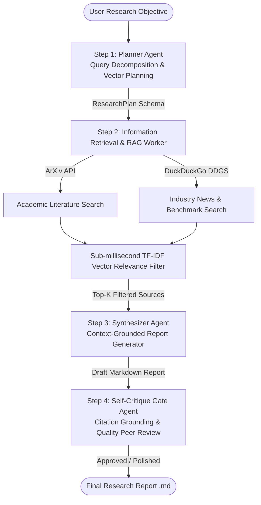
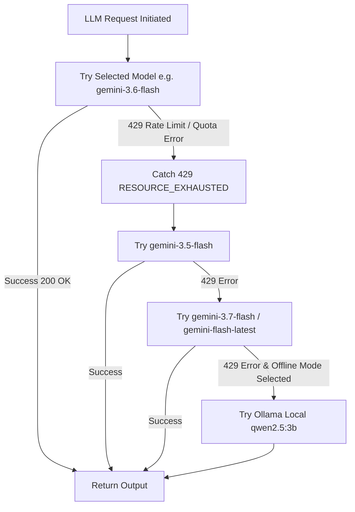
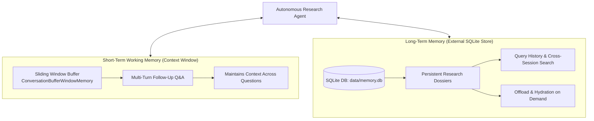
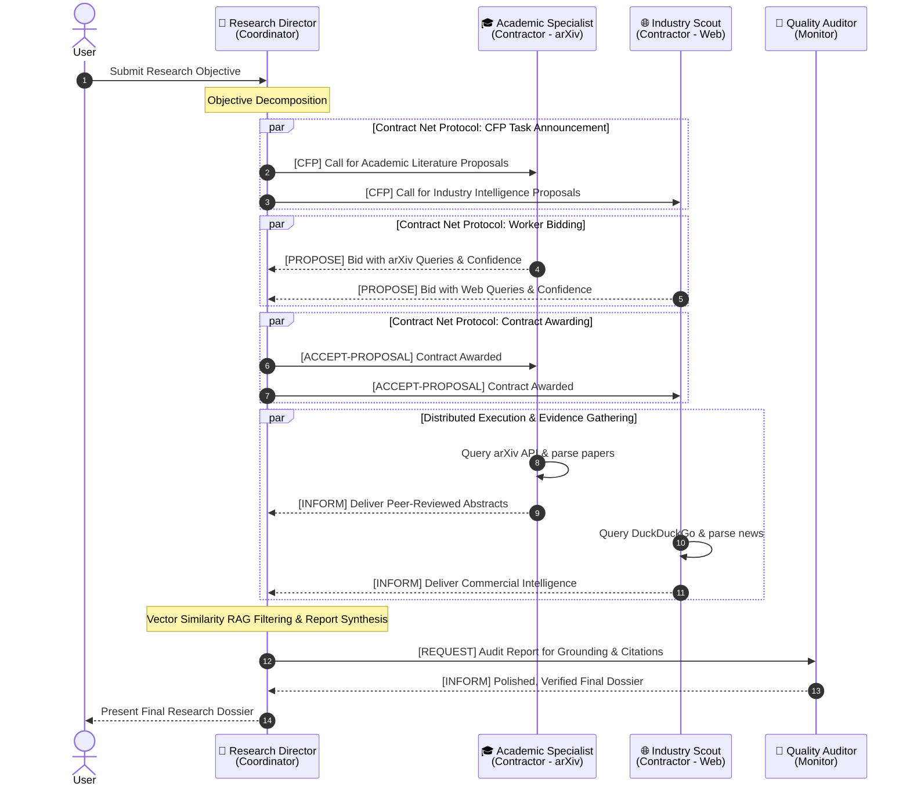
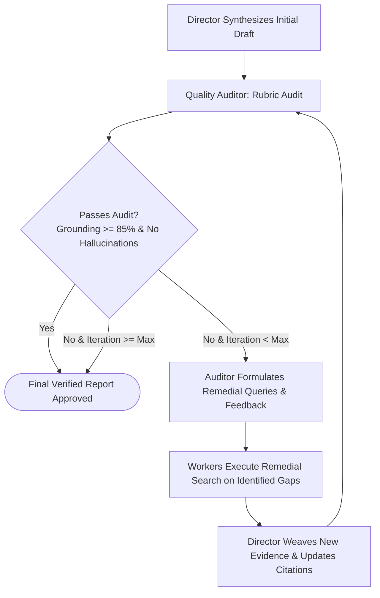
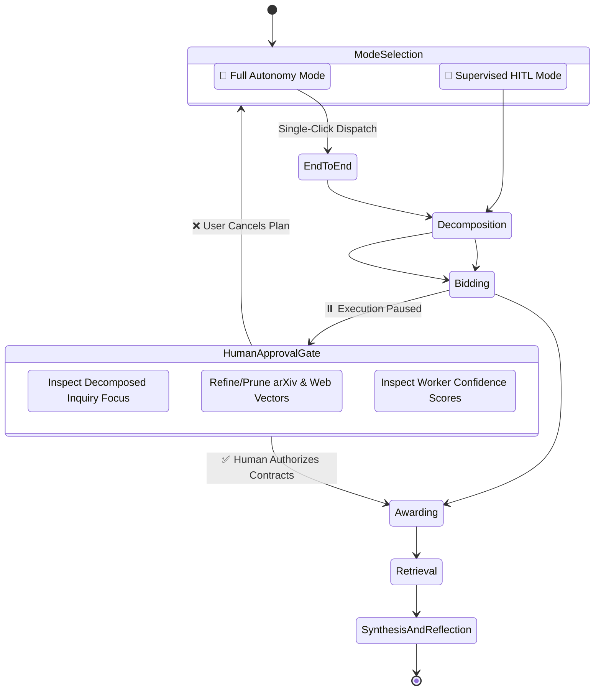
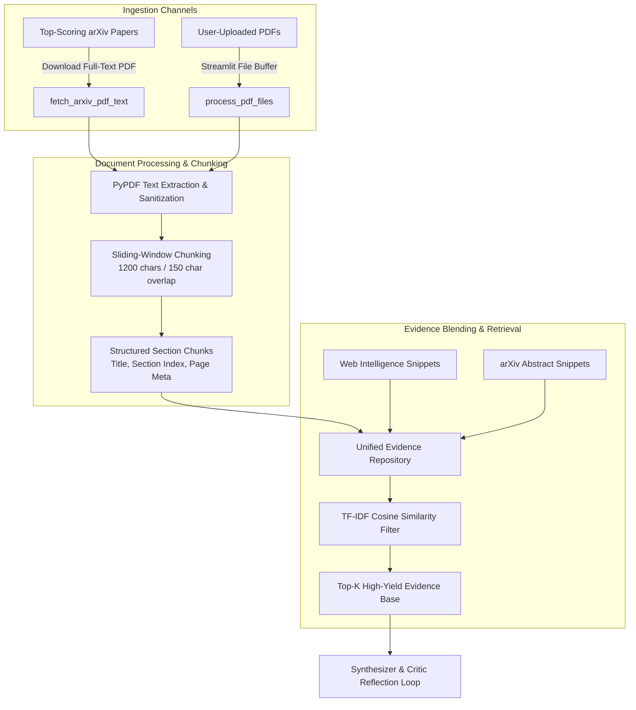

# Autonomous AI Research Assistant: Detailed Architecture & Pipeline Specification

## 1. System Overview & Architecture

The **Autonomous AI Research Assistant** is a stateful, multi-step agentic system built on **LangChain** and modern LLM orchestration patterns. It transforms abstract, multi-domain user research requests into structured, peer-reviewed, and cited intelligence reports.

The pipeline is completely **domain-agnostic** (capable of handling Game Design, Quantum Computing, Autonomous AI, Finance, Medicine, etc.) and operates in both **Online Mode** (via Google Gemini 3.6 Flash API with automatic rate-limit fallback) and **Offline Mode** (via local Ollama models such as `Qwen 2.5 3B` or `Llama 3.2`).



---

## 2. Technical Stack & Tooling Rationale

| Pipeline Layer | Technology / Tool | Rationale & Purpose |
| :--- | :--- | :--- |
| **Agent Orchestration** | `LangChain Core` | Manages stateful DAG flow, structured output schemas, system message prompts, and model abstraction. |
| **LLM Inference (Online)** | `ChatGoogleGenerativeAI` (`gemini-3.6-flash`) | Ultra-fast token generation (~200+ tps), 1M token context window, free tier tier availability. |
| **LLM Inference (Offline)** | `ChatOllama` (`qwen2.5:3b` / `llama3.2`) | 100% offline local inference without API keys, quota limits, or data privacy concerns. |
| **Academic Retrieval** | `arxiv` Python API (`arxiv.Client`) | Access to peer-reviewed scientific papers across all domains (`cs.GR`, `cs.AI`, `cs.CV`, `quant-ph`, etc.). |
| **Web Retrieval** | `duckduckgo-search` / `ddgs` (`DDGS().text`) | Fetches real-time industry announcements, commercial benchmarks, and tech news without requiring paid API keys. |
| **RAG Relevance Filter** | TF-IDF Cosine Scoring (`src/tools/rag.py`) | Sub-millisecond vector similarity filtering to isolate Top-K relevant sources without PyTorch CPU model overhead. |
| **Data Validation** | `Pydantic v2` | Enforces strict JSON data contracts for agent structured outputs (`ResearchPlan`). |
| **User Interface** | `Streamlit` | Interactive web UI with real-time execution status tracking, model switching, and 1-click Markdown downloads. |

---

## 3. Step-by-Step Pipeline Decomposition

### Step 1: Objective Understanding & Query Decomposition (Planner Node)

#### Purpose & Objective
Broad user queries (e.g., *"Research the latest developments in Game Development for game design"*) are too vague for direct search engine execution. The Planner Agent acts as a Research Director, decomposing the main goal into:
1. Targeted technical sub-questions.
2. Academic search queries for research papers.
3. Industry search queries for commercial developments.

#### Tools Used
- **LLM Engine**: `ChatGoogleGenerativeAI` or `ChatOllama`
- **LangChain Method**: `llm.with_structured_output(ResearchPlan)`
- **Pydantic Schema**: `ResearchPlan`

#### Input Prompt to LLM
```text
System: You are a Senior Academic & Industry Research Director.
Human: Decompose the following user research objective into a comprehensive, targeted research plan.

Objective: "{objective}"

Task:
1. Identify 3 specific sub-questions covering core technical/industry areas relevant to the objective.
2. Generate 2 targeted search queries for academic literature (ArXiv / paper search). Do NOT include specific category restrictions unless relevant.
3. Generate 2 targeted search queries for industry news, benchmarks, or announcements.
```

#### Output Data Structure (`ResearchPlan` Pydantic Schema)
```json
{
  "sub_questions": [
    "What are the latest procedural content generation (PCG) and generative AI techniques in game design?",
    "How are modern game engines (Unreal Engine 5, Unity) integrating real-time neural rendering and Nanite/Lumen tech?",
    "What player engagement and adaptive difficulty algorithms demonstrate state-of-the-art results?"
  ],
  "arxiv_queries": [
    "procedural content generation game design generative AI",
    "real-time neural rendering computer graphics game engine"
  ],
  "web_queries": [
    "game development game design breakthroughs 2025 2026",
    "unreal engine 5 unity game design technology announcements"
  ]
}
```

---

### Step 2: Information Retrieval & Vector Filtering (Worker Node)

#### Purpose & Objective
Executes multi-channel retrieval to gather raw scientific context (from ArXiv) and market context (from DuckDuckGo). The retrieved sources are then chunked and ranked by relevance to ensure the LLM receives clean, dense context without context pollution.

#### Tools Used
- **`arxiv.Search`**: Queries ArXiv API (`all:{query}`) sorting by relevance.
- **`DDGS().text`**: Queries DuckDuckGo Web Search API.
- **`filter_top_k_sources()`**: Calculates TF-IDF vector relevance scores between the original user objective and each retrieved source, returning the Top-K ($K=6$) highest scoring items.

#### Input Data Structure to Retrieval Workers
- ArXiv search query strings from `plan.arxiv_queries`
- Web search query strings from `plan.web_queries`

#### Output Data Structure (`List[Dict]` / `SourceItem`)
```python
[
  {
    "title": "Generative AI for Procedural Level Design in Modern Game Engines",
    "url": "http://arxiv.org/abs/2501.12345v1",
    "published": "2025-01-15",
    "content": "Title: Generative AI for Procedural Level Design...\nAuthors: ...\nSummary: We present a novel framework utilizing transformer-based diffusion models for generating 3D terrain and game levels...",
    "source_type": "Academic (ArXiv)",
    "score": 4.52
  },
  {
    "title": "State of Game Development 2025: Tech & Design Trends",
    "url": "https://example.com/game-dev-trends",
    "published": "Recent Industry News",
    "content": "Title: State of Game Development...\nSnippet: Industry leaders report widespread adoption of real-time ray tracing, dynamic audio synthesis, and AI-driven NPC behavior trees...",
    "source_type": "Industry Web",
    "score": 3.89
  }
]
```

---

### Step 3: Master Report Synthesis & Grounded Citation Indexing (Synthesizer Node)

#### Purpose & Objective
Synthesizes all retrieved intelligence into an academic-grade Markdown report. To eliminate AI hallucinations, the prompt explicitly instructs the LLM that **every single factual claim, metric, or benchmark MUST be explicitly tagged with a numerical citation index (`[1]`, `[2]`, etc.)** matching the provided context index.

#### Tools Used
- **LLM Engine**: `ChatGoogleGenerativeAI` or `ChatOllama`
- **LangChain Messages**: `SystemMessage` + `HumanMessage`
- **Output Extractor**: `_extract_text()` string normalizer

#### Input Prompt to LLM
```text
System: You produce rigorous, fact-grounded technical research summaries.
Human: You are an expert subject-matter specialist and technical writer.
Generate a structured, academic-grade research synthesis report based strictly on the retrieved context below.

User Objective: "{objective}"

Retrieved Context Sources:
[1] Title: Generative AI for Procedural Level Design...
    Type: Academic (ArXiv) | Date: 2025-01-15 | URL: http://arxiv.org/abs/2501.12345v1
    Content: ...

[2] Title: State of Game Development 2025...
    Type: Industry Web | Date: Recent Industry News | URL: https://example.com/game-dev-trends
    Content: ...

Report Structure Requirements:
# Autonomous Research Synthesis Report: [Topic Title based on Objective]

## Executive Summary
(Synthesize high-level breakthrough state-of-the-art developments)

## 1. Key Technical & Conceptual Breakthroughs
(Detailed breakdown of primary innovations, methodologies, architectures, or frameworks)

## 2. Industry Milestones vs. Academic Research
(Key advancements from industry leaders alongside peer-reviewed paper findings)

## 3. Open Challenges & Technical Roadblocks
(Current limitations, bottlenecks, or future outlook)

## 4. References & Citation Index
(List every cited source matching index [1], [2], etc., formatted with clickable URLs and publication dates)

CRITICAL INSTRUCTION: Every factual claim, benchmark, or statistic MUST be explicitly backed by a citation index like [1] or [2].
Do NOT make up any ungrounded citations.
```

#### Output Data Structure
- Draft Markdown string containing section headers, bullet points, code/diagram blocks, and numerical citation tags `[1]`, `[2]`.

---

### Step 4: Self-Critique & Refinement Loop (Evaluation Gate Node)

#### Purpose & Objective
Acts as an automated Peer Reviewer. It checks the draft report generated in Step 3 for:
1. Grounding verification (ensuring claims maintain valid `[1]`, `[2]` citation tags).
2. Completeness (ensuring all parts of the original objective were addressed).
3. GitHub Flavored Markdown formatting quality.

#### Tools Used
- **LLM Engine**: `ChatGoogleGenerativeAI` or `ChatOllama`
- **LangChain Messages**: `SystemMessage` (Peer Reviewer Role) + `HumanMessage`

#### Input Prompt to LLM
```text
System: You are an uncompromising peer reviewer ensuring 100% citation grounding and topic accuracy.
Human: You are a rigorous peer-reviewer for leading academic and technical publications.

Evaluate and refine the following research report:
Original Objective: "{objective}"

Report under review:
{draft_report}

Review Tasks:
1. Verify all numerical claims and breakthroughs contain proper citation tags `[1]`, `[2]`.
2. Ensure clear section hierarchy and polished GitHub Flavored Markdown formatting.
3. Verify that the content directly answers the original objective: "{objective}".
4. Output ONLY the finalized polished Markdown report.
```

#### Output Data Structure
- Finalized, polished Markdown string ready for rendering in Streamlit and saving to `Research_Report.md`.

---

## 4. Multi-Model Router & Error Recovery Architecture



### Key Error Handling Features:
1. **`FALLBACK_MODELS` List**: Automatically cycles through `["gemini-3.6-flash", "gemini-3.5-flash", "gemini-3.7-flash", "gemini-flash-latest", "ollama/qwen2.5:3b"]` upon encountering HTTP 429 quota exhaustion.
2. **`_extract_text()` Normalizer**: Safely parses complex model responses (whether returned as raw strings, list of text blocks `[{'type': 'text', 'text': '...'}]`, or object properties) to prevent string format crashes.

---

---

## 5. Dual-Tier Memory Architecture

The system incorporates a dual-tier memory architecture combining low-latency working context and persistent disk storage:



### 1. Short-Term Working Memory (`src/memory.py:ShortTermMemory`)
- **Location**: Lives inside the LLM working context window.
- **Mechanism**: Implements a sliding-window conversational buffer (`window_size=6`).
- **Function**: Enables the user to engage in multi-turn dialogues with the synthesized report (e.g., *"Elaborate on section 2"*, *"What are the exact hardware limits mentioned in source [1]?"*).
- **Context Retention**: Maintains working context across turns while bounding token consumption so the context window is never exhausted.

### 2. Long-Term Persistent Memory (`src/memory.py:LongTermMemory`)
- **Location**: External ACID-compliant SQLite store (`data/memory.db`).
- **Mechanism**: Persists research sessions containing `session_id`, `objective`, `topic_title`, `plan_json`, `sources_json`, `final_report`, and `chat_history_json`.
- **Function**: Allows users to reload past research dossiers across browser sessions, search prior findings, and maintain a cumulative knowledge repository without re-running expensive LLM pipelines.

---

## 6. Role-Based Agents & Contract Net Protocol (CNP) Architecture

The research assistant coordinates a decentralized team of specialized agents governed by the **Contract Net Protocol (CNP)** and standard **FIPA-ACL communication performatives**:



### Team Roles & Responsibilities

| Agent Entity | System Role | Primary Responsibilities | Tools & Data Sources |
| :--- | :--- | :--- | :--- |
| **`DirectorAgent`** | **Coordinator / Manager** | Decomposes goals, manages CNP bidding and awards, synthesizes cross-domain findings into structured reports. | LLM Orchestrator, FIPA-ACL Router, Memory Manager |
| **`AcademicLiteratureAgent`** | **Contractor / Worker** | Bids on scientific tasks, formulates academic queries, queries arXiv preprints, extracts mathematical methodologies. | `arxiv` API, Academic Parser |
| **`IndustryIntelligenceAgent`** | **Contractor / Worker** | Bids on commercial tasks, queries real-time tech news, extracts hardware benchmarks and product releases. | `duckduckgo-search` API, Web Text Scraper |
| **`QualityCriticAgent`** | **Monitor / Verifier** | Audits citation tags (`[1]`, `[2]`), enforces factual grounding against retrieved sources, and polishes formatting. | Peer Review Evaluator, Citation Auditor |

### FIPA-ACL Message Performatives Used

1. **`CFP` (Call for Proposals)**: Broadcasted by the Coordinator to announce decomposed research tasks.
2. **`PROPOSE` (Bid)**: Submitted by Contractor agents containing targeted search queries, domain rationale, and confidence scores.
3. **`ACCEPT_PROPOSAL` (Award)**: Issued by Coordinator to authorize winning bidders to execute their search contracts.
4. **`INFORM` (Deliver)**: Used by Workers to deliver retrieved evidence and by the Auditor to return the verified report.
5. **`REQUEST` (Audit)**: Used by Coordinator to trigger the Quality Auditor's peer-review verification gate.

---

## 7. Autonomous Self-Correction & Reflection Loop (Self-Healing Pipeline)

The system does not treat research generation as a static forward pass. It introduces a closed-loop **Self-Correction & Reflection Gate**:



### Reflection Cycle Mechanics
1. **Rubric-Based Quality Evaluation**:
   - **Grounding Score (0-100)**: Assesses the percentage of factual claims backed by explicit index citations `[1]`, `[2]`.
   - **Citation Density Score (0-100)**: Assesses reference distribution across all sections.
   - **Sub-Question Coverage**: Verifies that every technical sub-question formulated during planning is answered with cited evidence.
2. **Remedial Search Triggering**:
   - If the audit fails, the Auditor generates 1-2 targeted remedial search queries targeting the exact information gaps.
   - The Director issues remedial contracts to worker agents, retrieving missing evidence without rerunning the entire pipeline.
3. **Evidence Integration & Re-Synthesis**:
   - The Director merges the new sources with the existing evidence base, updates the draft, and resubmits it for audit.
4. **Auditing Trace & Persistence**:
   - Every iteration cycle records its grounding score, citation density, feedback notes, and remedial actions, displaying a real-time **Reflection Timeline** in the UI and persisting it to SQLite long-term memory.

---

## 8. Human-in-the-Loop (HITL) & Adjustable Autonomy Architecture

To ensure high-stakes reliability and calibrated user trust, the system implements **Adjustable Autonomy**, enabling dynamic transitions between fully autonomous and human-supervised operational modes:



### Key Operational Characteristics
1. **Dynamic Execution Decoupling**:
   - In **Supervised Mode**, the agent decouples planning (`prepare_plan_for_approval`) from execution (`execute_from_approved_plan`).
   - The system pauses immediately after contractors submit their query proposals (`PROPOSE`), presenting their confidence ratings, rationale, and specific query vectors for human inspection.
2. **Interactive Search Vector Refinement**:
   - The user can prune irrelevant search queries, correct terminology, or inject domain constraints directly in the UI before search API quotas are consumed.
3. **Calibrated Mixed-Initiative Agency**:
   - The user acts as the strategic supervisor, while autonomous agents handle computational retrieval, vector similarity ranking, synthesis, and peer review.

---

## 9. Deep Paper Ingestion: Full-Text PDF Reader & Document RAG

### Overview & Motivation
Standard automated research assistants rely solely on search snippets and brief academic abstracts. However, academic paper abstracts typically compress 10-30 pages of research into 200 words, omitting critical details:
- Mathematical equations, proofs, and algorithmic pseudo-code.
- Detailed hyperparameter configurations, benchmark matrices, and ablation tables.
- Specific implementation challenges, failure modes, and architectural designs.

To achieve production-grade domain depth, the **Deep Paper Ingestion** subsystem extends the research assistant with full-text PDF processing and document Retrieval-Augmented Generation (RAG).



### Technical Implementation

#### 1. Ingestion Pipeline (`src/tools/pdf_reader.py`)
- **Streamlined Extraction (`extract_text_from_pdf`)**: Consumes file-like byte streams or disk paths using `pypdf.PdfReader`. Extracts text on a per-page basis with defensive error handling for encrypted or corrupted documents.
- **Context-Preserving Sliding Window Chunking (`chunk_document_text`)**: Segments long documents into contiguous semantic chunks (1,200 characters with 150-character sliding overlap). Each chunk retains metadata indicating source document name, section index, and character spans to preserve provenance during report citation.
- **Autonomous arXiv PDF Fetcher (`fetch_arxiv_pdf_text`)**:
  - Automatically converts arXiv abstract URLs (`https://arxiv.org/abs/2301.12345`) to direct PDF endpoints (`https://arxiv.org/pdf/2301.12345.pdf`).
  - Utilizes custom request headers (`User-Agent: AutonomousResearchAssistant/1.0`) with SSL verification and timeouts to comply with academic repository rate policies.
  - Automatically extracts and chunks the top-ranking papers during academic contractor execution.
- **Multi-File Batch Handler (`process_pdf_files`)**: Accepts Streamlit `UploadedFile` streams, normalizes titles, extracts body text, and produces standardized source dictionaries tagged as `Uploaded Research PDF`.

#### 2. Contractor Integration (`src/agents/academic_worker.py`)
- When `deep_read=True` is enabled, the **Academic Literature Specialist** (`AcademicWorker`) evaluates candidate papers retrieved from the arXiv API.
- For the highest-relevance paper, it invokes `deep_read_paper()`, fetching the complete PDF, decomposing it into semantic chunks, and scoring each chunk against the specific sub-query.
- High-yield methodology sections and result tables are promoted into the evidence base tagged as `Academic (Full-Text PDF)`.

#### 3. Blended Multi-Modal Evidence Base
The pipeline unifies disparate data sources into a single vectorized retrieval pool:
1. **Academic Theory**: Full-text peer-reviewed papers and arXiv preprints.
2. **Industry Real-Time Context**: Web announcements, product release notes, and documentation from DuckDuckGo.
3. **Proprietary Knowledge**: User-uploaded whitepapers, internal technical briefs, or confidential reports.

All sources flow through the sub-millisecond TF-IDF cosine relevance filter, ensuring the Synthesizer receives only top-scoring, noise-free context chunks.


