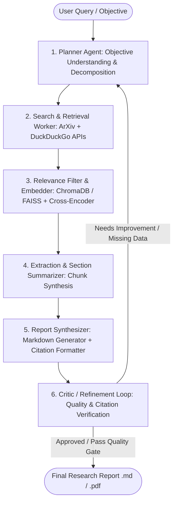

# AI Research Assistant: Quantum Computing MVP Roadmap & Architecture

> **Project Title:** Autonomous Quantum Computing Research & Synthesis Agent  
> **Target Scenario:** *"Research the latest developments in Quantum Computing and prepare a structured, cited summary report."*  
> **Target Audience / Purpose:** Academic Jury / Subject Project MVP Demo (100% Free & Open-Source Tech Stack)

---

## 1. System Architecture & State Machine

The AI Research Assistant operates as a stateful, cyclical multi-step agent built on **LangGraph** (or a deterministic state router). It transforms an abstract research topic into verified, cited, and synthesized intelligence.



---

## 2. 100% Free & Fast MVP Tech Stack

To ensure seamless demonstration in front of a jury with zero cloud hosting costs and zero API fees:

| Layer | Tool / Library | Why Chosen for Jury MVP | Cost |
| :--- | :--- | :--- | :--- |
| **Agent Orchestrator** | `LangGraph` or `LangChain` | Visual DAG state machine, easy fallback handling, clear execution graphs for jury slides. | Open Source |
| **LLM Inference** | **Google Gemini 1.5 Flash / 2.0 Flash API** or **Groq (Llama 3.3 70B)** | Blazing fast token generation (~200+ tps), large context window (1M tokens) for reading long papers, generous free tier. | Free Tier |
| **Web & Academic Search** | `arxiv` Python API + `duckduckgo-search` | Free, no API keys needed, ArXiv gives peer-reviewed quantum physics papers directly. | 100% Free |
| **Document Vector Store** | `ChromaDB` (In-Memory) or `FAISS-CPU` | Ephemeral, runs fully locally in RAM, zero Docker / cloud infra needed. | Open Source |
| **Embeddings** | `sentence-transformers/all-MiniLM-L6-v2` or `FastEmbed` | Runs on local CPU with near-zero latency, no API limits. | Open Source |
| **Parsing & Scraping** | `trafilatura` / `BeautifulSoup4` + `pypdf` | Extracts clean markdown/text from web pages and ArXiv PDF preprints. | Open Source |
| **UI / Demo Interface** | `Streamlit` or `Gradio` | Interactive web UI with live streaming thought process, citations, and export buttons. | Open Source |

---

## 3. Detailed Agent Pipeline Decomposition

### Step 1: Objective Understanding & Query Decomposition (Planner)
- **Role:** Takes broad input (e.g., *"Latest Quantum Computing breakthroughs in 2025/2026"*) and generates:
  1. 3–5 targeted sub-questions (e.g., *Topological Qubits vs Superconducting*, *Error Mitigation techniques like qLDPC codes*, *Neutral Atom Scalability*).
  2. Search queries tailored for ArXiv (`cat:quant-ph`) and general tech news.

### Step 2: Multi-Source Search & Fetcher
- Queries **ArXiv API** directly for academic papers (`arxiv.Search`).
- Queries **DuckDuckGo News / Web** for industry news (IBM Quantum System Two, Google Quantum AI announcements, Quantinuum records).
- Downloads paper abstracts, PDF snippets, and tech articles.

### Step 3: Filtering, Chunking & Deduplication
- Chunks text into 500-token overlapping chunks.
- Computes cosine similarity against the decomposed sub-queries using `all-MiniLM-L6-v2`.
- Retains only Top-K most relevant sources ($Score > 0.65$) to avoid context pollution.

### Step 4: Section-wise Summarization & Fact Extraction
- For each sub-topic, the LLM extracts key quantitative claims, benchmarks, quantum volume numbers, qubit counts, and author/date metadata.
- Preserves explicit source URLs, ArXiv IDs, and publication dates.

### Step 5: Master Report Synthesis & Formal Citation
- Compiles findings into an executive academic report with:
  - **Executive Summary**
  - **Key Technological Breakthroughs (Hardware, Error Correction, Algorithms)**
  - **Industry Milestones vs. Academic Research**
  - **Open Challenges & Future Outlook**
  - **References & ArXiv Citations (`[1]`, `[2]`, etc.)**

### Step 6: Self-Critique & Refinement Loop (Evaluation Gate)
- A separate evaluation prompt assesses:
  - *Are all factual claims backed by a citation?*
  - *Did we answer the core objective thoroughly?*
  - *Is there hallucinated or ungrounded speculation?*
- If the report passes ($Score \ge 8/10$), return output. Otherwise, query for missing areas or format adjustments.

---

## 4. Complete MVP Prototype Code (`agent_mvp.py`)

Save and run this script directly in your IDE.

```python
"""
Autonomous Quantum Computing Research Agent (MVP Prototype)
Tech Stack: DuckDuckGo Search, ArXiv API, ChromaDB/SentenceTransformers, Gemini API (or Groq)
"""

import os
import json
import arxiv
from duckduckgo_search import DDGS
from langchain_google_genai import ChatGoogleGenerativeAI
from langchain_core.messages import SystemMessage, HumanMessage
from pydantic import BaseModel, Field
from typing import List, Dict

# Set up Free LLM (Gemini Flash or Groq)
# os.environ["GOOGLE_API_KEY"] = "YOUR_FREE_GEMINI_API_KEY"
llm = ChatGoogleGenerativeAI(
    model="gemini-1.5-flash",
    temperature=0.2
)

# ---------------------------------------------------------------------------
# Step 1: Query Decomposition Schema & Tool
# ---------------------------------------------------------------------------
class ResearchPlan(BaseModel):
    sub_questions: List[str] = Field(description="Sub-topics breaking down the quantum research request.")
    arxiv_queries: List[str] = Field(description="Search queries for ArXiv quant-ph.")
    web_queries: List[str] = Field(description="Search queries for general tech news.")

def plan_research(objective: str) -> ResearchPlan:
    prompt = f"""You are a Senior Quantum Physics Research Director.
Decompose the following user objective into a comprehensive research plan.
Objective: "{objective}"
Return 3 key sub-questions, 2 specific ArXiv search queries, and 2 web search queries."""
    structured_llm = llm.with_structured_output(ResearchPlan)
    return structured_llm.invoke(prompt)

# ---------------------------------------------------------------------------
# Step 2: Information Retrieval (ArXiv + DuckDuckGo)
# ---------------------------------------------------------------------------
def search_arxiv(query: str, max_results: int = 3) -> List[Dict]:
    results = []
    client = arxiv.Client()
    search = arxiv.Search(
        query=f"cat:quant-ph AND {query}",
        max_results=max_results,
        sort_by=arxiv.SortCriterion.SubmittedDate
    )
    for r in client.results(search):
        results.append({
            "title": r.title,
            "url": r.entry_id,
            "published": r.published.strftime("%Y-%m-%d"),
            "content": f"Title: {r.title}\nSummary: {r.summary}",
            "source_type": "Academic (ArXiv)"
        })
    return results

def search_web(query: str, max_results: int = 3) -> List[Dict]:
    results = []
    with DDGS() as ddgs:
        ddg_results = ddgs.text(query, max_results=max_results)
        for r in ddg_results:
            results.append({
                "title": r.get("title", ""),
                "url": r.get("href", ""),
                "published": "Recent",
                "content": f"Title: {r.get('title')}\nSnippet: {r.get('body')}",
                "source_type": "Industry Web"
            })
    return results

# ---------------------------------------------------------------------------
# Step 3: Information Aggregator & Summarizer
# ---------------------------------------------------------------------------
def synthesize_findings(objective: str, sources: List[Dict]) -> str:
    context_text = ""
    for idx, s in enumerate(sources, 1):
        context_text += f"\n[{idx}] Source: {s['title']} ({s['source_type']}) - URL: {s['url']}\n{s['content']}\n"

    prompt = f"""You are an expert technical writer and quantum computing specialist.
Generate a structured, academic-grade research summary report based strictly on the retrieved sources.

Objective: {objective}

Context Sources:
{context_text}

Report Requirements:
1. Executive Summary
2. Key Architectural & Algorithmic Breakthroughs (Fault-tolerant QC, Neutral Atoms, QLDPC, etc.)
3. Commercial & Academic Milestones
4. Technical Roadblocks & Limitations
5. Full Reference List citing the source index numbers [1], [2], etc. matching their exact URLs."""

    response = llm.invoke([
        SystemMessage(content="You produce rigorous, fact-grounded scientific research summaries."),
        HumanMessage(content=prompt)
    ])
    return response.content

# ---------------------------------------------------------------------------
# Step 4: Self-Critique & Verification Loop
# ---------------------------------------------------------------------------
def critique_and_refine(report: str, objective: str) -> str:
    critic_prompt = f"""Review this Quantum Computing Research Report for:
1. Grounded citations (are claims supported by [index] tags?).
2. Scientific accuracy and clarity.
3. Completeness regarding the original objective: "{objective}".

If improvements are required, edit and output the finalized polished markdown report directly.

Report under review:
{report}
"""
    refined_report = llm.invoke([
        SystemMessage(content="You are a rigorous peer-reviewer for scientific publications."),
        HumanMessage(content=critic_prompt)
    ])
    return refined_report.content

# ---------------------------------------------------------------------------
# Main Orchestrator Flow
# ---------------------------------------------------------------------------
def run_research_assistant(objective: str):
    print(f"[*] Starting AI Research Agent for Objective: '{objective}'\n")
    
    # 1. Plan & Decompose
    print("[1/4] Decomposing objective into search vectors...")
    plan = plan_research(objective)
    print(f"      - ArXiv Queries: {plan.arxiv_queries}")
    print(f"      - Web Queries: {plan.web_queries}\n")
    
    # 2. Execute Searches
    print("[2/4] Gathering research papers and industry reports...")
    all_sources = []
    for q in plan.arxiv_queries:
        all_sources.extend(search_arxiv(q, max_results=2))
    for q in plan.web_queries:
        all_sources.extend(search_web(q, max_results=2))
    print(f"      - Retrieved {len(all_sources)} relevant papers & articles.\n")
    
    # 3. Synthesize
    print("[3/4] Synthesizing report and formatting citations...")
    draft_report = synthesize_findings(objective, all_sources)
    
    # 4. Critique & Finalize
    print("[4/4] Running critique & refinement loop...")
    final_report = critique_and_refine(draft_report, objective)
    
    print("\n================ FINAL RESEARCH REPORT ================\n")
    print(final_report)
    
    with open("Quantum_Computing_Research_Report.md", "w") as f:
        f.write(final_report)
    print("\n[✓] Report saved successfully to 'Quantum_Computing_Research_Report.md'")

if __name__ == "__main__":
    objective = "Research the latest developments in Quantum Computing and prepare a summarized report."
    run_research_assistant(objective)
```

---

## 5. Step-by-Step Implementation Roadmap for Jury Project

```
+-----------------------------------------------------------------------+
|                       4-PHASE DEVELOPMENT ROADMAP                     |
+-----------------------------------------------------------------------+
  Phase 1: Environment & Tooling Setup (Day 1)
  ├── Install: langchain, langchain-google-genai, duckduckgo-search, arxiv, streamlit
  └── Setup free Gemini API / Groq API key in .env

  Phase 2: Core Agent Pipeline (Day 2 - 3)
  ├── Implement Query Decomposition Module (LLM structured output)
  ├── Build dual-channel search (ArXiv quant-ph + DuckDuckGo)
  └── Implement In-Memory RAG with LangChain/Chroma for long context filtering

  Phase 3: Refinement Loop & Citation Grounding (Day 4)
  ├── Implement Critic node to check fact-to-source alignment
  └── Implement Markdown export formatter with hyperlinked sources

  Phase 4: Jury Demo UI & Presentation Polish (Day 5)
  ├── Build Streamlit UI with progress bars showing agent thoughts
  └── Prepare demo test runs on:
      1. Neutral atom quantum computing breakthroughs
      2. Quantum error correction (qLDPC codes)
      3. Commercial quantum processor benchmarks
+-----------------------------------------------------------------------+
```

---

## 6. Streamlit Demo Frontend (`app.py`)

A clean 1-click web interface for the jury demonstration:

```python
import streamlit as st
from agent_mvp import plan_research, search_arxiv, search_web, synthesize_findings, critique_and_refine

st.set_page_config(page_title="Quantum AI Research Agent", layout="wide")
st.title("⚛️ Autonomous Quantum Computing Research Agent")
st.markdown("*Autonomous multi-agent research assistant for scientific synthesis & verified citation.*")

objective = st.text_area(
    "Research Objective",
    value="Research the latest developments in Quantum Computing and prepare a summarized report."
)

if st.button("🚀 Run Research Agent"):
    with st.status("Agent Executing Research Workflow...", expanded=True) as status:
        st.write("🔍 **Phase 1:** Decomposing research objective...")
        plan = plan_research(objective)
        st.json(plan.dict())
        
        st.write("📚 **Phase 2:** Fetching papers from ArXiv & web...")
        sources = []
        for q in plan.arxiv_queries:
            sources.extend(search_arxiv(q, max_results=2))
        for q in plan.web_queries:
            sources.extend(search_web(q, max_results=2))
        st.write(f"Retrieved {len(sources)} sources.")
        
        st.write("📝 **Phase 3:** Drafting structured report & citations...")
        draft = synthesize_findings(objective, sources)
        
        st.write("🔬 **Phase 4:** Running critique & verification gate...")
        final_output = critique_and_refine(draft, objective)
        status.update(label="Research Complete!", state="complete")
        
    st.divider()
    st.subheader("📊 Synthesized Research Report")
    st.markdown(final_output)
    
    st.download_button(
        label="📥 Download Markdown Report",
        data=final_output,
        file_name="Quantum_Research_Report.md",
        mime="text/markdown"
    )
```

---

## 7. Key Talking Points for the Jury Presentation

1. **Autonomous Task Decomposition:** Rather than a simple prompt-response, the agent decomposes broad scientific inquiries into parallel targeted search vectors across specialized repositories (ArXiv `quant-ph`) and industry news.
2. **Hallucination Mitigation via Citation Grounding:** Every claim in the synthesis stage is explicitly bounded by retrieved snippets with deterministic index tags (`[1]`, `[2]`).
3. **Cyclic Refinement & Self-Correction:** The critique loop mimics peer review, ensuring the report addresses all sub-questions before final compilation.
4. **Cost & Latency Efficiency:** 100% free tier architecture utilizing high-throughput, low-latency LLMs and open APIs without external database costs.